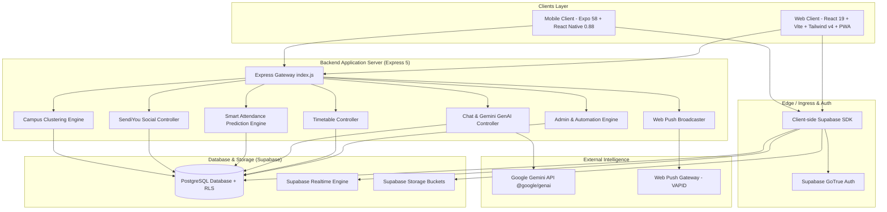
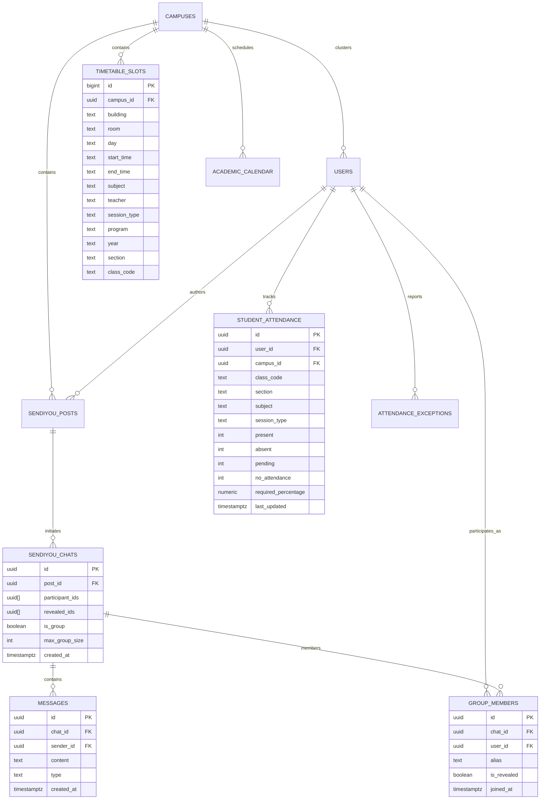

# 🏛️ Timbel Architecture Document

> **System Architecture & Technical Specifications**  
> **Platform**: Timbel (Timetable Detector & Campus Super-App) by **Cosen**  
> **Version**: 2.5 (Multi-Campus, Smart Attendance, Realtime SendiYou, Native Mobile)  
> **Last Updated**: November 2026  

---

## 1. Architectural Overview

Timbel is an end-to-end campus operations and social intelligence platform designed to eliminate daily friction for university students, professors, and administrative heads. The system is split into three primary tiers:

1. **Client Tier**:
   - **Web Application**: Built on **React 19**, **Vite 8**, **Tailwind CSS v4**, **Three.js** (WebGL 3D graphics), and a Service Worker-backed PWA.
   - **Native Mobile Application**: Built on **React Native 0.88**, **Expo 58**, **NativeWind v4**, **React Navigation 7**, and **Reanimated 4**.
2. **Backend Service Tier**:
   - **Node.js (Express 5.x)** serving REST endpoints, Excel spreadsheet parsing, Google Gemini AI orchestration, and Web Push notifications.
3. **Data & Realtime Tier (Supabase)**:
   - **PostgreSQL 15+** database with Row-Level Security (RLS).
   - **Supabase Realtime (WebSockets)** for peer-to-peer and group messaging.
   - **Supabase GoTrue** for session authentication and campus OAuth flows.
   - **Supabase Storage** for user attachments and anonymous post media.

---

## 2. Component Breakdown

### 2.1 Web Client (`/client`)
- **Core Framework**: React 19 + Vite 8 with ESM.
- **Styling Architecture**: Tailwind CSS v4 using CSS variables and `@theme` directives configured in `index.css`.
- **State Management**:
  - `AuthContext.jsx`: Handles Supabase session persistence, active user profiles, token refresh, and campus affiliation.
  - `NotificationContext.jsx`: Manages Web Push subscription handshakes and notification banners.
- **Key Modules**:
  - `FinderPage.jsx`: Real-time classroom vacancy tracker with building filters and dynamic time-scrubber.
  - `ClassTimetablePage.jsx`: Batch-wise master timetable grid supporting split labs and multi-teacher slots.
  - `TeacherStatusPage.jsx`: Live faculty locator displaying current room, next upcoming lecture, and department filters.
  - `AttendancePlannerPage.jsx`: Smart Attendance Bunker integrating ERP inputs, timetable schedules, and university academic calendars.
  - `SendiYouPage.jsx` & `ChatPage.jsx`: Anonymous student feed, individual chats, and group chat channels.
  - `AdminPage.jsx`: Admin dashboard with Excel upload, manual slot CRUD, AI-driven conflict resolution, and user moderation.
- **3D & Visual Aesthetics**: Three.js integration (`@react-three/fiber`, `@react-three/drei`), custom WebGL shaders (`Hero3D.jsx`, `QuantumBackground.jsx`, `Prism.jsx`, `PixelBlast.jsx`), and Lottie animations (`lottie-react`).

### 2.2 Mobile Client (`/mobile`)
- **Core Framework**: React Native 0.88 + Expo 58 with New Architecture compatibility.
- **Styling**: NativeWind v4 matching Tailwind v4 tokens defined in `src/theme/index.js`.
- **Navigation**: React Navigation v7 with a unified `TabNavigator` and `NativeStack` wrapper (`MainNavigator.js`).
- **Feature Parity**: Native screens replicating Finder, Teachers, Class Timetables, Attendance Planner, SendiYou Feed, Anonymous Chat Rooms, and Profile.
- **Native Capabilities**: Expo Notifications, Haptics, Image Picker, Document Picker, and Async Storage.

### 2.3 Backend API Server (`/server`)
- **Framework**: Express.js 5 running on Node.js.
- **Route Modules**:
  - `/api/timetable`: Dynamic room vacancy calculation, slot searching, class schedules, and teacher statuses.
  - `/api/admin`: Secure endpoints protected by `auth.js` middleware for Excel uploads (`multer`), SQL execution, slot mutations, and conflict approvals.
  - `/api/chat`: Gemini Function Calling integration using `@google/genai` with automated database querying tools (`searchTimetable`).
  - `/api/attendance`: Prediction algorithms calculating required attendance, safe bunk allowances, academic calendar reconciliation, and AI bunk advising.
  - `/api/sendiyou`: Anonymous group creation, alias assignments (`group_members`), membership kicks, and identity reveals.
  - `/api/campuses`: University multi-tenant clustering and domain discovery.
  - `/api/notifications`: VAPID push notification subscription storage and broadcasting.

### 2.4 Database & Persistence (Supabase PostgreSQL)
- **Multi-Tenant Architecture**: Multi-campus segregation powered by `campus_id UUID` foreign keys across all entity tables.
- **Row-Level Security (RLS)**: Enforced across `student_attendance`, `attendance_exceptions`, `sendiyou_chats`, `messages`, and `group_members` to guarantee complete privacy and zero data leaks.
- **Realtime Replication**: `sendiyou_chats`, `messages`, and `group_members` are published via Supabase Realtime for instant sub-100ms messaging.

---

## 3. Data Models & Database Schemas

### 3.1 Entity Relationship Diagram

### 3.2 Schema Specifications

#### `campuses`
Represents isolated university institutions:
- `id` (UUID, Primary Key)
- `name` (TEXT, e.g., 'Parul University', 'P. P. Savani University')
- `short_name` (TEXT, e.g., 'PU', 'PPSU')
- `email_domains` (TEXT[], e.g., `['@ppsu.ac.in']`)
- `created_at` (TIMESTAMPTZ)

#### `timetable_slots`
Represents scheduled lectures and laboratories:
- `id` (BIGINT, Primary Key)
- `campus_id` (UUID, FK -> campuses.id)
- `building` (TEXT, indexed)
- `room` (TEXT, indexed)
- `day` (TEXT, e.g., 'MON', 'TUE', 'WED', 'THU', 'FRI', 'SAT')
- `start_time` (TEXT, 24h format 'HH:MM')
- `end_time` (TEXT, 24h format 'HH:MM')
- `subject` (TEXT)
- `teacher` (TEXT)
- `session_type` (TEXT, 'LEC', 'LAB', 'TUT', 'Event')
- `program` (TEXT)
- `year` (TEXT)
- `section` (TEXT)
- `class_code` (TEXT, indexed)

#### `student_attendance`
Stores individual subject attendance status:
- `id` (UUID, Primary Key)
- `user_id` (UUID, FK -> auth.users.id)
- `campus_id` (UUID, FK -> campuses.id)
- `class_code` (TEXT)
- `section` (TEXT)
- `subject` (TEXT)
- `session_type` (TEXT, 'LEC' or 'LAB')
- `present` (INT, default 0)
- `absent` (INT, default 0)
- `pending` (INT, default 0)
- `no_attendance` (INT, default 0)
- `required_percentage` (NUMERIC, default 75.00)
- `last_updated` (TIMESTAMPTZ)

#### `academic_calendar`
Stores institutional holidays, exam blocks, and semester boundaries:
- `id` (UUID, Primary Key)
- `campus_id` (UUID, FK -> campuses.id)
- `event_date` (DATE)
- `event_type` ('HOLIDAY', 'VACATION', 'EXAM', 'HALF_DAY')
- `event_name` (TEXT)
- `affects_all` (BOOLEAN)
- `affected_classes` (TEXT[])
- `semester_start` (DATE)
- `semester_end` (DATE)

#### `sendiyou_posts`
Campus anonymous board entries:
- `id` (UUID, Primary Key)
- `creator_id` (UUID, FK -> users.id)
- `campus_id` (UUID, FK -> campuses.id)
- `title` (TEXT)
- `description` (TEXT)
- `connection_type` (TEXT, e.g., 'study', 'crush', 'lost_found', 'chill')
- `preferred_gender` (TEXT)
- `lottie_animation` (TEXT, identifier of Lottie asset)
- `is_anonymous` (BOOLEAN, default true)
- `expires_at` (TIMESTAMPTZ)
- `created_at` (TIMESTAMPTZ)

#### `sendiyou_chats` & `group_members`
Anonymous chat rooms with dynamic identity masking:
- `sendiyou_chats`: `id`, `post_id`, `participant_ids`, `revealed_ids`, `is_group`, `max_group_size`, `created_at`
- `group_members`: `id`, `chat_id`, `user_id`, `alias` (e.g. 'ShadowWolf', 'NeonPanda'), `is_revealed`, `joined_at`

---

## 4. Key Data Flows & Sequences

### 4.1 Room Vacancy Calculation Flow
1. Client sends building name, target day (`MON`...`SAT`), target time (`HH:MM`), and campus ID to `/api/timetable/rooms`.
2. Backend converts target time to total minutes since midnight ($T_{\text{target}}$).
3. Backend fetches all known rooms for the campus/building from `timetable_slots`.
4. Backend retrieves all slots for the specified day and evaluates:
   $$\text{Room Busy} \iff \exists \text{ slot } s \text{ s.t. } \text{start\_min}(s) \le T_{\text{target}} < \text{end\_min}(s)$$
5. If free, it checks upcoming slots to determine when the next session starts:
   - If next session starts in $\le 15$ min: marked **SOON** (Amber).
   - If free for $> 15$ min: marked **FREE** (Emerald) with duration.
   - If occupied: marked **BUSY** (Red) showing current subject, teacher, and end time.
6. Returns sorted list (Free rooms first) with complete schedule cards.

### 4.2 Smart Attendance Prediction Algorithm
The prediction engine combines three layers:
1. **Historical Ledger**: Current recorded $(P)$ present and $(A)$ absent counts from student ERP input.
2. **Timetable Recurrence Matrix**: Queries `timetable_slots` to find recurrence frequency of each subject per week.
3. **Calendar Blackout Mask**: Scans `academic_calendar` from current date up to `semester_end`, filtering out public holidays, vacations, and exam dates.

$$\text{Future Lectures } (F) = \sum_{d = \text{today}}^{\text{semester\_end}} \mathbb{I}(\text{lecture occurs on } d \land d \notin \text{Holidays})$$

- **Max Achievable Attendance %**:
  $$\text{Max} \% = \frac{P + F}{P + A + F} \times 100$$
- **Lectures Needed to Hit Target $(T\%)$**:
  $$\text{Needed } (X) = \left\lceil \frac{T \cdot (P + A) - 100 \cdot P}{100 - T} \right\rceil$$
- **Safe Bunks Allowed**:
  $$\text{Bunks } (B) = \left\lfloor \frac{100 \cdot (P + F) - T \cdot (P + A + F)}{100} \right\rfloor$$

### 4.3 AI Chat Assistant Function Calling Sequence
1. Student asks natural language question (e.g., *"Is room H509 free right now?"* or *"What is my ME5 schedule on Friday?"*).
2. Express backend forwards prompt and chat history to Gemini via `@google/genai`.
3. Gemini uses Tool Declarations:
   - Tool `searchTimetable(building, room, day, time, teacher, class_code)`
   - Tool `reportIssue(room, day, time, description)`
4. If Gemini determines tool invocation is required, backend executes the SQL query against Supabase.
5. Backend returns the tool output JSON to Gemini.
6. Gemini synthesizes a natural, concise Hinglish/English answer without exposing raw database column names.

---

## 5. Security & Authentication Architecture

1. **Authentication Handshake**:
   - Google OAuth and Email Magic Link authenticated via Supabase GoTrue.
   - User profile auto-synced with college email domain to derive campus affiliation and enrollment number.
2. **Role-Based Access Control (RBAC)**:
   - Standard Student: Access to public timetables, own attendance, own chats.
   - Campus Admin: Verified via JWT claims or service credentials. Exclusive access to Excel parser, slot insertion, slot deletion, and SendiYou moderation.
3. **Anonymity Protections**:
   - `sendiyou_posts` hides author UUID by default on the client layer.
   - Chat aliases are strictly randomized (`group_members.alias`).
   - Mutual reveal protocol requires both sides or explicit user action to write into `revealed_ids`.
4. **Row Level Security (RLS)**:
   - Enforced at PostgreSQL layer ensuring users cannot alter other students' attendance records or inspect unjoined chats even if client code is modified.

---

## 6. Deployment & Infrastructure Pipeline

- **Client Hosting**: Vercel / Netlify with automated CI/CD for web application.
- **Backend Hosting**: Railway / Render / DigitalOcean App Platform running Dockerized Node.js.
- **Database & Storage**: Managed Supabase Cloud (AWS ap-south-1 Mumbai region for optimal Indian subcontinent latency).
- **Mobile Distribution**: EAS (Expo Application Services) Build producing Android APK/AAB and iOS IPA for App Store / Play Store releases.
- **Monitoring & Error Tracking**: Supabase dashboard metrics, Express structured error logs, and client-side error boundaries.
