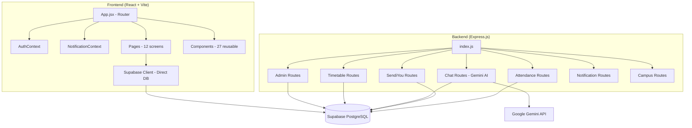

# 🚀 Timbel: Web → React Native Conversion Roadmap

## 📋 Project Understanding

### What Is Timbel?

A **campus management platform** called "Timbel" (Timetable Detector) built by **Cosen**, with these major modules:

| Module                       | Description                                                      | Key Files                                                                                                                                                                                                                                                                                                               |
| ---------------------------- | ---------------------------------------------------------------- | ----------------------------------------------------------------------------------------------------------------------------------------------------------------------------------------------------------------------------------------------------------------------------------------------------------------------- |
| **Timetable Finder**   | Search rooms/slots by building, day, time                        | [FinderPage.jsx](file:///c:/Users/HP/OneDrive/Desktop/Projects/timbel/client/src/pages/FinderPage.jsx)                                                                                                                                                                                                                   |
| **Class Timetable**    | View full class schedules                                        | [ClassTimetablePage.jsx](file:///c:/Users/HP/OneDrive/Desktop/Projects/timbel/client/src/pages/ClassTimetablePage.jsx)                                                                                                                                                                                                   |
| **Teacher Status**     | Check teacher availability                                       | [TeacherStatusPage.jsx](file:///c:/Users/HP/OneDrive/Desktop/Projects/timbel/client/src/pages/TeacherStatusPage.jsx)                                                                                                                                                                                                     |
| **SendiYou**           | Anonymous campus social platform with posts, chats, messaging    | [SendiYouPage.jsx](file:///c:/Users/HP/OneDrive/Desktop/Projects/timbel/client/src/pages/SendiYouPage.jsx), [ChatPage.jsx](file:///c:/Users/HP/OneDrive/Desktop/Projects/timbel/client/src/pages/ChatPage.jsx), [MessagesPage.jsx](file:///c:/Users/HP/OneDrive/Desktop/Projects/timbel/client/src/pages/MessagesPage.jsx) |
| **AI Assistant**       | Gemini-powered chatbot with function-calling for live DB queries | [AIAssistantWidget.jsx](file:///c:/Users/HP/OneDrive/Desktop/Projects/timbel/client/src/components/AIAssistantWidget.jsx)                                                                                                                                                                                                |
| **Admin Panel**        | Full CRUD for slots, AI analysis, user management                | [AdminPage.jsx](file:///c:/Users/HP/OneDrive/Desktop/Projects/timbel/client/src/pages/AdminPage.jsx)                                                                                                                                                                                                                     |
| **Attendance Planner** | Smart attendance tracking & planning                             | [AttendancePlannerPage.jsx](file:///c:/Users/HP/OneDrive/Desktop/Projects/timbel/client/src/pages/AttendancePlannerPage.jsx)                                                                                                                                                                                             |
| **Profile**            | User profile management                                          | [ProfilePage.jsx](file:///c:/Users/HP/OneDrive/Desktop/Projects/timbel/client/src/pages/ProfilePage.jsx)                                                                                                                                                                                                                 |

### Current Tech Stack

| Layer              | Technology                                                             |
| ------------------ | ---------------------------------------------------------------------- |
| Frontend           | React 19 + Vite                                                        |
| Styling            | Tailwind CSS v4                                                        |
| Routing            | React Router DOM v7                                                    |
| Auth & DB          | Supabase (PostgreSQL + GoTrue)                                         |
| Backend            | Node.js + Express.js                                                   |
| AI                 | Google Gemini SDK (`@google/genai`)                                  |
| Animations         | Lottie React, Three.js (`@react-three/fiber`, `@react-three/drei`) |
| Icons              | Lucide React                                                           |
| File Upload        | Multer                                                                 |
| Push Notifications | Web Push (service worker)                                              |
| PWA                | `vite-plugin-pwa` with InjectManifest strategy                       |

### Current Architecture



---

## 🎯 Recommended Native Framework

### **React Native + Expo** (Recommended)

> [!IMPORTANT]
> Since your entire frontend is React-based, **React Native with Expo** is the best choice. You keep the same React mental model, reuse ~60-70% of your business logic, and the `@supabase/supabase-js` library works identically in React Native.

**Why React Native + Expo?**

- ✅ You already know React — smallest learning curve
- ✅ Supabase JS client is cross-platform compatible (works in RN out of the box)
- ✅ Your Express.js backend stays **100% unchanged**
- ✅ Expo provides native push notifications, camera, file picker, deep links
- ✅ Single codebase → iOS + Android
- ✅ Lottie works natively (`lottie-react-native`)
- ✅ Google Sign-In has official Expo plugin

---

## 📊 Conversion Complexity Analysis

### What Transfers Directly (Low Effort)

| Item                                   | Reason                                         |
| -------------------------------------- | ---------------------------------------------- |
| Supabase client + all DB queries       | `@supabase/supabase-js` is platform-agnostic |
| AuthContext logic                      | Only auth redirect method changes              |
| All `useState` / `useEffect` hooks | React hooks are identical                      |
| Express.js backend (100%)              | Zero changes needed                            |
| API call logic (`fetch`)             | Works the same                                 |
| Gemini AI integration                  | Backend-only, untouched                        |

### What Needs Rewriting (Medium Effort)

| Item                                   | Web                                | Native Equivalent                               |
| -------------------------------------- | ---------------------------------- | ----------------------------------------------- |
| All JSX (HTML elements)                | `<div>`, `<span>`, `<input>` | `<View>`, `<Text>`, `<TextInput>`         |
| Tailwind CSS                           | Tailwind classes                   | `StyleSheet.create()` or NativeWind           |
| React Router DOM                       | `<Routes>`, `<Route>`          | React Navigation (`@react-navigation/native`) |
| `window.location` / URL manipulation | Browser APIs                       | React Navigation params                         |
| `localStorage`                       | Web Storage API                    | `@react-native-async-storage/async-storage`   |
| Lottie                                 | `lottie-react`                   | `lottie-react-native`                         |
| Icons                                  | `lucide-react`                   | `lucide-react-native`                         |

### What Needs Complete Rebuild (High Effort)

| Item                          | Why                                                                                        |
| ----------------------------- | ------------------------------------------------------------------------------------------ |
| Three.js / 3D Hero            | No `@react-three/fiber` in RN — use `expo-gl` + `three` or replace with Lottie/Skia |
| Service Worker (Push)         | Replace with `expo-notifications` (native push)                                          |
| PWA manifest / install prompt | Not needed — native app IS the install                                                    |
| Particle backgrounds (WebGL)  | Replace with `react-native-skia` or simpler animations                                   |
| `react-markdown` rendering  | Use `react-native-markdown-display`                                                      |
| Google OAuth redirect flow    | Use `expo-auth-session` or `@react-native-google-signin/google-signin`                 |
| File upload (Multer)          | Use `expo-document-picker` / `expo-image-picker` on client                             |

---

## 🗺️ Step-by-Step Conversion Plan

### Phase 0: Pre-Setup (Day 1)

> [!NOTE]
> Keep your web project as-is. Create the React Native project in a new `mobile/` directory alongside the existing `client/` and `server/`.

```
timbel/
├── client/          ← Existing web app (keep unchanged)
├── server/          ← Existing backend (shared by both)
├── mobile/          ← NEW React Native app
│   ├── app/         ← Screen routes (Expo Router file-based)
│   ├── components/  ← Reusable native components
│   ├── context/     ← Auth & Notification contexts
│   ├── hooks/       ← Shared custom hooks
│   ├── lib/         ← Supabase client, API helpers
│   ├── assets/      ← Fonts, Lottie JSONs, images
│   └── utils/       ← Utility functions
└── package.json     ← Root monorepo config
```

**Tasks:**

- [ ] Install Node.js 18+ (if not already)
- [ ] Install Expo CLI: `npm install -g expo-cli`
- [ ] Create new Expo project: `npx create-expo-app@latest ./mobile --template blank`
- [ ] Set up Expo Router for file-based routing
- [ ] Configure TypeScript (optional but recommended)

---

### Phase 1: Foundation & Auth (Days 2-4)

**Goal:** Boot the app, connect to Supabase, implement Google Sign-In.

#### 1.1 Install Core Dependencies

```bash
cd mobile
npx expo install @supabase/supabase-js @react-native-async-storage/async-storage
npx expo install expo-auth-session expo-web-browser expo-crypto
npx expo install @react-navigation/native @react-navigation/native-stack @react-navigation/bottom-tabs
npx expo install react-native-screens react-native-safe-area-context
```

#### 1.2 Supabase Client (Reuse Logic)

Port [supabaseClient.js](file:///c:/Users/HP/OneDrive/Desktop/Projects/timbel/client/src/supabaseClient.js) with AsyncStorage adapter:

```javascript
// mobile/lib/supabase.js
import { createClient } from '@supabase/supabase-js';
import AsyncStorage from '@react-native-async-storage/async-storage';

const supabaseUrl = process.env.EXPO_PUBLIC_SUPABASE_URL;
const supabaseAnonKey = process.env.EXPO_PUBLIC_SUPABASE_ANON_KEY;

export const supabase = createClient(supabaseUrl, supabaseAnonKey, {
  auth: {
    storage: AsyncStorage,       // ← Key difference from web
    autoRefreshToken: true,
    persistSession: true,
    detectSessionInUrl: false,   // ← No URL detection in native
  },
});
```

#### 1.3 Auth Context (Port from Web)

Port [AuthContext.jsx](file:///c:/Users/HP/OneDrive/Desktop/Projects/timbel/client/src/context/AuthContext.jsx):

- Replace `localStorage` → `AsyncStorage`
- Replace `window.location.origin` → deep link scheme
- Replace `supabase.auth.signInWithOAuth()` → `expo-auth-session` flow
- Keep all the campus verification logic (`handleCampusAuth`) exactly as-is

#### 1.4 Google Sign-In

```javascript
// Using expo-auth-session
import * as Google from 'expo-auth-session/providers/google';

const [request, response, promptAsync] = Google.useAuthRequest({
  androidClientId: 'YOUR_ANDROID_CLIENT_ID',
  iosClientId: 'YOUR_IOS_CLIENT_ID',
});

// On response, exchange token with Supabase
useEffect(() => {
  if (response?.type === 'success') {
    const { id_token } = response.params;
    supabase.auth.signInWithIdToken({
      provider: 'google',
      token: id_token,
    });
  }
}, [response]);
```

---

### Phase 2: Navigation & Layout Shell (Days 5-7)

**Goal:** Recreate the app skeleton with all screens and navigation.

#### 2.1 Navigation Structure

Map your current [App.jsx](file:///c:/Users/HP/OneDrive/Desktop/Projects/timbel/client/src/App.jsx) routes to React Navigation:

```
Web Route                    →  Native Screen
─────────────────────────────────────────────
/                            →  LandingScreen (or skip → Finder)
/finder                      →  FinderScreen (Tab)
/classes                     →  ClassesScreen (Tab)
/teachers                    →  TeachersScreen (Tab)
/sendiyou                    →  SendiYouScreen (Tab)
/sendiyou/post/:postId       →  PostDetailScreen (Stack)
/chat/:chatId                →  ChatScreen (Stack)
/messages                    →  MessagesScreen (Tab/Stack)
/profile                     →  ProfileScreen (Tab)
/attendance                  →  AttendanceScreen (Stack)
/admin                       →  AdminScreen (Stack)
```

#### 2.2 Bottom Tab Navigator

Port [MobileBottomNav.jsx](file:///c:/Users/HP/OneDrive/Desktop/Projects/timbel/client/src/components/MobileBottomNav.jsx) to React Navigation's `BottomTabNavigator`:

```javascript
import { createBottomTabNavigator } from '@react-navigation/bottom-tabs';
const Tab = createBottomTabNavigator();

<Tab.Navigator>
  <Tab.Screen name="Finder" component={FinderScreen} />
  <Tab.Screen name="Classes" component={ClassesScreen} />
  <Tab.Screen name="SendiYou" component={SendiYouScreen} />
  <Tab.Screen name="Messages" component={MessagesScreen} />
  <Tab.Screen name="Profile" component={ProfileScreen} />
</Tab.Navigator>
```

#### 2.3 Port Components

Convert HTML→Native for shared components:

| Web Component                                                                                                          | Native Component  | Key Changes                                         |
| ---------------------------------------------------------------------------------------------------------------------- | ----------------- | --------------------------------------------------- |
| [Navbar.jsx](file:///c:/Users/HP/OneDrive/Desktop/Projects/timbel/client/src/components/Navbar.jsx)                     | Header bar        | Use `SafeAreaView` + custom header                |
| [ProtectedRoute.jsx](file:///c:/Users/HP/OneDrive/Desktop/Projects/timbel/client/src/components/ProtectedRoute.jsx)     | Auth gate         | Check auth state, redirect to login screen          |
| [RoomCard.jsx](file:///c:/Users/HP/OneDrive/Desktop/Projects/timbel/client/src/components/RoomCard.jsx)                 | Same structure    | `<View>` instead of `<div>`                     |
| [StatusBadge.jsx](file:///c:/Users/HP/OneDrive/Desktop/Projects/timbel/client/src/components/StatusBadge.jsx)           | Same structure    | `<View>` + `<Text>`                             |
| [BuildingSelector.jsx](file:///c:/Users/HP/OneDrive/Desktop/Projects/timbel/client/src/components/BuildingSelector.jsx) | Picker            | Use `@react-native-picker/picker` or custom modal |
| [DaySelector.jsx](file:///c:/Users/HP/OneDrive/Desktop/Projects/timbel/client/src/components/DaySelector.jsx)           | Horizontal scroll | `ScrollView horizontal` with buttons              |
| [TimeSelector.jsx](file:///c:/Users/HP/OneDrive/Desktop/Projects/timbel/client/src/components/TimeSelector.jsx)         | Picker            | Modal picker or flat list                           |

---

### Phase 3: Core Screens (Days 8-15)

**Goal:** Port all major screens one by one.

> [!TIP]
> Work in this order — each screen builds on the patterns from the previous one.

#### 3.1 FinderPage → FinderScreen (Days 8-9)

Port [FinderPage.jsx](file:///c:/Users/HP/OneDrive/Desktop/Projects/timbel/client/src/pages/FinderPage.jsx):

- All Supabase queries stay the same
- Replace Tailwind grids → `FlatList` with column layout
- Replace `<select>` → `Picker` or custom bottom sheet
- Replace CSS animations → `Animated` API or `react-native-reanimated`

#### 3.2 ClassTimetablePage → ClassesScreen (Day 10)

Port [ClassTimetablePage.jsx](file:///c:/Users/HP/OneDrive/Desktop/Projects/timbel/client/src/pages/ClassTimetablePage.jsx):

- Replace HTML table → `FlatList` or `SectionList`
- Port [ScheduleAccordion.jsx](file:///c:/Users/HP/OneDrive/Desktop/Projects/timbel/client/src/components/ScheduleAccordion.jsx) → use `LayoutAnimation` for expand/collapse

#### 3.3 TeacherStatusPage → TeachersScreen (Day 11)

Port [TeacherStatusPage.jsx](file:///c:/Users/HP/OneDrive/Desktop/Projects/timbel/client/src/pages/TeacherStatusPage.jsx):

- Similar to Finder — search + list pattern
- Badge component ports easily

#### 3.4 SendiYouPage → SendiYouScreen (Days 12-13)

Port [SendiYouPage.jsx](file:///c:/Users/HP/OneDrive/Desktop/Projects/timbel/client/src/pages/SendiYouPage.jsx) (52KB — biggest screen):

- Post feed → `FlatList` with pull-to-refresh
- Post creation modal → use `react-native-modal` or `@gorhom/bottom-sheet`
- Lottie animation selection → `lottie-react-native`
- Campus login modal → port [CampusLoginModal.jsx](file:///c:/Users/HP/OneDrive/Desktop/Projects/timbel/client/src/components/CampusLoginModal.jsx)

#### 3.5 ChatPage + MessagesPage (Days 14-15)

Port [ChatPage.jsx](file:///c:/Users/HP/OneDrive/Desktop/Projects/timbel/client/src/pages/ChatPage.jsx) and [MessagesPage.jsx](file:///c:/Users/HP/OneDrive/Desktop/Projects/timbel/client/src/pages/MessagesPage.jsx):

- Consider using `react-native-gifted-chat` for the chat UI
- Supabase realtime subscriptions work identically in RN
- Keyboard handling: use `KeyboardAvoidingView`

---

### Phase 4: AI Assistant & Advanced Features (Days 16-20)

#### 4.1 AI Assistant Widget

Port [AIAssistantWidget.jsx](file:///c:/Users/HP/OneDrive/Desktop/Projects/timbel/client/src/components/AIAssistantWidget.jsx):

- Floating button → `TouchableOpacity` with `position: 'absolute'`
- Chat overlay → Full-screen modal or bottom sheet
- Markdown rendering → `react-native-markdown-display`
- All `/api/chat/ask` calls stay the same

#### 4.2 Attendance Planner

Port [AttendancePlannerPage.jsx](file:///c:/Users/HP/OneDrive/Desktop/Projects/timbel/client/src/pages/AttendancePlannerPage.jsx) (73KB — complex):

- Calendar views → `react-native-calendars`
- Charts/stats → `react-native-chart-kit` or `victory-native`
- Data logic transfers directly

#### 4.3 Profile Page

Port [ProfilePage.jsx](file:///c:/Users/HP/OneDrive/Desktop/Projects/timbel/client/src/pages/ProfilePage.jsx):

- Image picker → `expo-image-picker`
- Storage uploads to Supabase Storage stay the same

---

### Phase 5: Admin Panel (Days 21-23)

Port [AdminPage.jsx](file:///c:/Users/HP/OneDrive/Desktop/Projects/timbel/client/src/pages/AdminPage.jsx) (87KB — largest file):

- Tabs → use `@react-navigation/material-top-tabs` or custom tab bar
- Data tables → `FlatList` with card-based layout
- Excel upload → `expo-document-picker` + same Multer backend
- AI Analysis markdown → `react-native-markdown-display`
- Port [SendiyouAdminTab.jsx](file:///c:/Users/HP/OneDrive/Desktop/Projects/timbel/client/src/components/SendiyouAdminTab.jsx)

---

### Phase 6: Native-Only Features (Days 24-28)

#### 6.1 Push Notifications (Replace Web Push)

Replace [PushNotificationManager.jsx](file:///c:/Users/HP/OneDrive/Desktop/Projects/timbel/client/src/components/PushNotificationManager.jsx) and [sw.js](file:///c:/Users/HP/OneDrive/Desktop/Projects/timbel/client/src/sw.js):

```bash
npx expo install expo-notifications expo-device expo-constants
```

- Register for native push tokens (APNs / FCM)
- Store tokens in `push_subscriptions` table (modify existing schema)
- Backend sends via FCM instead of `web-push`

#### 6.2 Deep Linking

- Configure URL scheme: `timbel://`
- Handle `timbel://sendiyou/post/:postId` and `timbel://chat/:chatId`
- Configure Universal Links (iOS) / App Links (Android) for sharing

#### 6.3 3D / Visual Effects Replacement

Your web app uses Three.js heavily for visual effects:

- [Hero3D.jsx](file:///c:/Users/HP/OneDrive/Desktop/Projects/timbel/client/src/components/Hero3D.jsx) → Replace with premium Lottie animation or `react-native-skia`
- [ParticleBackground.jsx](file:///c:/Users/HP/OneDrive/Desktop/Projects/timbel/client/src/components/ParticleBackground.jsx) → Use `react-native-reanimated` + `react-native-skia`
- [QuantumBackground.jsx](file:///c:/Users/HP/OneDrive/Desktop/Projects/timbel/client/src/components/QuantumBackground.jsx) → Simplify to gradient + animated particles via Skia
- [Prism.jsx](file:///c:/Users/HP/OneDrive/Desktop/Projects/timbel/client/src/components/Prism.jsx) → Lottie or Skia shader
- [PixelBlast.jsx](file:///c:/Users/HP/OneDrive/Desktop/Projects/timbel/client/src/components/PixelBlast.jsx) → Skia canvas animation

#### 6.4 Offline Support

- Use `@react-native-community/netinfo` for connectivity detection
- Cache timetable data in AsyncStorage for offline viewing
- Queue chat messages when offline, sync when online

---

### Phase 7: Polish & Testing (Days 29-35)

#### 7.1 Styling System

Choose one approach:

| Option                                 | Pros                                | Cons                                      |
| -------------------------------------- | ----------------------------------- | ----------------------------------------- |
| **NativeWind (Tailwind for RN)** | Reuse Tailwind class names from web | Learning curve, config differences        |
| **StyleSheet.create()**          | Native performance, no dependencies | Manual conversion of every Tailwind class |
| **Tamagui / Gluestack**          | Cross-platform, theme support       | New abstraction to learn                  |

> [!TIP]
> Since you already know Tailwind, **NativeWind v4** is recommended — it lets you reuse your Tailwind knowledge and even share some class names between web and native.

#### 7.2 Testing

- Unit tests: Jest (comes with Expo)
- Component tests: React Native Testing Library
- E2E: Maestro (easiest for RN) or Detox
- Test on real devices (not just simulators)

#### 7.3 Performance

- Use `FlatList` everywhere instead of `ScrollView` for lists
- Memoize heavy components with `React.memo`
- Use `useCallback` for all event handlers passed to lists
- Profile with React DevTools and Flipper

---

### Phase 8: Build & Release (Days 36-40)

#### 8.1 App Store Setup

```bash
# Build for production
npx expo prebuild          # Generate native projects
eas build --platform all   # Build via EAS Build
```

- Create Apple Developer Account ($99/year)
- Create Google Play Developer Account ($25 one-time)
- Generate app icons and splash screens from your [cosen_brand_logo.svg](file:///c:/Users/HP/OneDrive/Desktop/Projects/timbel/client/src/assets/cosen_brand_logo.svg)
- Prepare store listings, screenshots, descriptions

#### 8.2 Environment Configuration

```javascript
// app.config.js (Expo config)
export default {
  expo: {
    name: "Timbel",
    slug: "timbel",
    scheme: "timbel",
    ios: {
      bundleIdentifier: "com.cosen.timbel",
      googleServicesFile: "./GoogleService-Info.plist",
    },
    android: {
      package: "com.cosen.timbel",
      googleServicesFile: "./google-services.json",
    },
    extra: {
      supabaseUrl: process.env.EXPO_PUBLIC_SUPABASE_URL,
      supabaseAnonKey: process.env.EXPO_PUBLIC_SUPABASE_ANON_KEY,
    },
  },
};
```

---

## 📦 Complete Dependency Map: Web → Native

| Web Package               | Native Replacement                  | Install Command                                      |
| ------------------------- | ----------------------------------- | ---------------------------------------------------- |
| `react-dom`             | `react-native`                    | Included with Expo                                   |
| `react-router-dom`      | `@react-navigation/native`        | `npx expo install @react-navigation/native`        |
| `tailwindcss`           | `nativewind`                      | `npm install nativewind tailwindcss`               |
| `lottie-react`          | `lottie-react-native`             | `npx expo install lottie-react-native`             |
| `lucide-react`          | `lucide-react-native`             | `npm install lucide-react-native react-native-svg` |
| `react-markdown`        | `react-native-markdown-display`   | `npm install react-native-markdown-display`        |
| `@react-three/fiber`    | `react-native-skia` / `expo-gl` | `npx expo install @shopify/react-native-skia`      |
| `@react-three/drei`     | N/A (rebuild effects)               | —                                                   |
| `vite-plugin-pwa`       | `expo-notifications`              | `npx expo install expo-notifications`              |
| `web-push` (server)     | FCM via `firebase-admin`          | `npm install firebase-admin` (server only)         |
| `@supabase/supabase-js` | Same! ✅                            | Already compatible                                   |

---

## ⏱️ Timeline Summary

| Phase                                | Duration   | What's Done                                             |
| ------------------------------------ | ---------- | ------------------------------------------------------- |
| **Phase 0** — Setup           | Day 1      | Expo project, folder structure                          |
| **Phase 1** — Auth            | Days 2-4   | Supabase, Google Sign-In, Auth flow                     |
| **Phase 2** — Navigation      | Days 5-7   | All screens wired, bottom tabs, header                  |
| **Phase 3** — Core Screens    | Days 8-15  | Finder, Classes, Teachers, SendiYou, Chat               |
| **Phase 4** — Advanced        | Days 16-20 | AI Assistant, Attendance, Profile                       |
| **Phase 5** — Admin           | Days 21-23 | Full admin panel conversion                             |
| **Phase 6** — Native Features | Days 24-28 | Push notifications, deep links, offline, visual effects |
| **Phase 7** — Polish          | Days 29-35 | Styling, testing, performance                           |
| **Phase 8** — Release         | Days 36-40 | Store submissions, CI/CD                                |

> **Total Estimated Time: 6-8 weeks** (for a solo developer working full-time)

---

## 🔑 Critical Decisions to Make Before Starting

1. **Keep the web app running alongside native?** (Recommended: Yes — let the web PWA serve desktop users, native app for mobile)
2. **NativeWind vs StyleSheet.create?** (Recommended: NativeWind — leverage your Tailwind knowledge)
3. **Expo Router vs React Navigation?** (Recommended: Expo Router — file-based like Next.js, modern approach)
4. **Skip Three.js effects or rebuild in Skia?** (Recommended: Replace with premium Lottie animations — faster to build, better battery life)
5. **TypeScript?** (Recommended: Yes — add it from the start for the native project even if the web app doesn't use it)

---

## ⚠️ Risks & Gotchas

> [!WARNING]
> **OAuth Redirect:** Supabase's `signInWithOAuth` uses browser redirects. In React Native, you must use `signInWithIdToken` after getting the Google token via `expo-auth-session`. This is the #1 blocker most people hit.

> [!WARNING]
> **Large Files:** Your [AdminPage.jsx](file:///c:/Users/HP/OneDrive/Desktop/Projects/timbel/client/src/pages/AdminPage.jsx) is 87KB and [AttendancePlannerPage.jsx](file:///c:/Users/HP/OneDrive/Desktop/Projects/timbel/client/src/pages/AttendancePlannerPage.jsx) is 73KB. These should be broken into smaller sub-components during the native conversion.

> [!CAUTION]
> **Push Notifications:** Your current web push system (`web-push` + service worker) won't work in native. You need to add a parallel FCM/APNs path to your Express server alongside the existing web-push logic — don't remove it, since the web app still needs it.

> [!NOTE]
> **Backend stays unchanged** for all API routes. The only server-side addition is the FCM notification sender running alongside your existing `web-push` sender.
