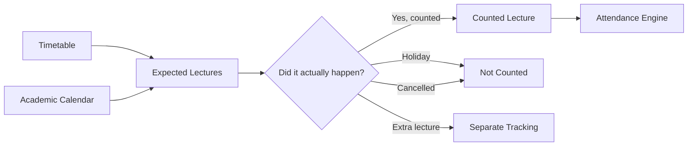
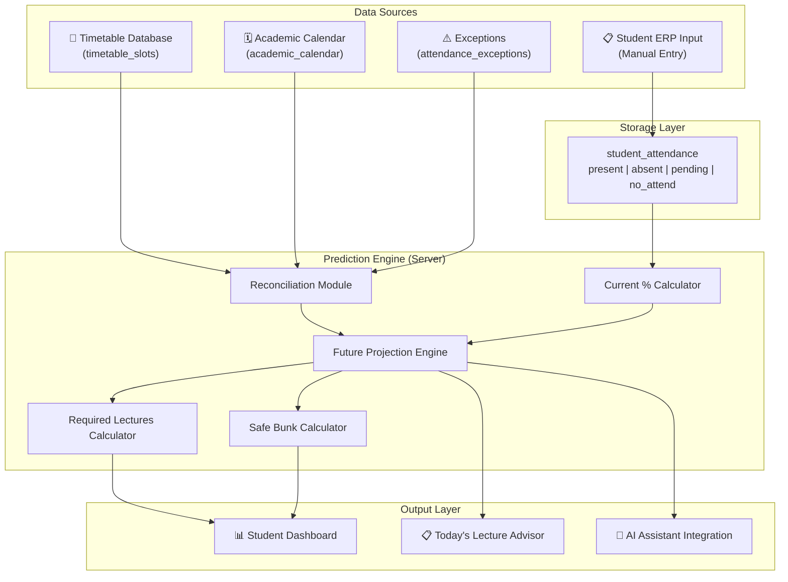

# 🎯 Smart Attendance Planner — Investigation & Feasibility Report

## Executive Summary

The **Smart Attendance Planner** is a genuinely compelling extension to the existing **timbel** platform. It transforms a simple attendance percentage into an **actionable intelligence system** by combining three data sources (ERP attendance, timetable, academic calendar) with a prediction engine. This report investigates the idea's novelty, technical feasibility, architecture, and a concrete implementation path within your existing codebase.

---

## 1. Is This a New Idea?

### What Already Exists in the Market

| Tool | What It Does | What It Doesn't Do |
|------|-------------|-------------------|
| **College ERP portals** (e.g., AKTU ERP, MIS portals) | Show current attendance % per subject | No predictions, no "how many to attend", no calendar awareness |
| **Attendance Calculator apps** (Play Store) | Simple present/total → percentage | No subject-wise analysis, no timetable integration, no future planning |
| **Bunkomatic / BunkManager** | "How many can I bunk?" calculator | Static formula only — no real timetable, no calendar, no pending status handling |
| **College-specific apps** (unofficial) | Sometimes show timetable + attendance | No prediction engine, no reconciliation with calendar |

### What Makes Your Idea Different

> [!IMPORTANT]
> **The key differentiator is the fusion of three independent data sources into a prediction engine.** No existing tool in the Indian college ecosystem does this.

| Dimension | Existing Tools | Your System |
|-----------|---------------|-------------|
| Attendance view | Single % number | Per-subject breakdown with risk indicators |
| Pending lectures | Ignored or treated as absent | Shown as a **range** (best/worst case) |
| "How many to attend?" | Generic formula, user calculates | **Automatic per-subject**, with date-aware timeline |
| "How many can I bunk?" | Simple math, no context | **Calendar-aware** — knows which days have that subject |
| Cancelled/Extra lectures | Not handled | **Exception system** — user reports, engine adjusts |
| Future attendance | Not predicted | **Predicted** using timetable + calendar + current data |
| Timetable awareness | None | **Deep integration** — knows exactly when each subject occurs |
| Academic calendar | None | **Holiday/exam/vacation filtering** on future lectures |

### Verdict: **Yes, This Is a Genuinely Novel Idea**

The concept of reconciling *"what has happened" (ERP)* with *"what should happen" (timetable + calendar)* to produce *"what will happen"* is architecturally distinct from anything available. The four-status model (Present/Absent/Pending/No Attendance) adds a layer of realism that simple calculators completely ignore.

---

## 2. Core Concepts Deep-Dive

### 2.1 The Four-Status Model

This is the intellectual backbone of the system:

```
┌─────────────┬──────────────────────────────────────────────────────┐
│ Status      │ Meaning                                              │
├─────────────┼──────────────────────────────────────────────────────┤
│ PRESENT     │ Counted lecture → student attended → +1 numerator    │
│ ABSENT      │ Counted lecture → student didn't attend → +1 denom  │
│ PENDING     │ Lecture exists but status unresolved → EXCLUDED      │
│ NO_ATTEND   │ Lecture slot exists but shouldn't count → EXCLUDED   │
└─────────────┴──────────────────────────────────────────────────────┘
```

**Why this matters:**

```
Base formula:    attendance% = present / (present + absent) × 100
With pending:    range = [present/(present+absent+pending), (present+pending)/(present+absent+pending)]
```

The pending-awareness creates **honesty** — instead of a false single number, students see their actual risk window.

### 2.2 Expected vs. Counted Lectures



This distinction is critical because:
- **Expected** = timetable says it should happen
- **Counted** = it actually affects attendance
- A cancelled lecture is *expected* but *not counted*
- An extra lecture may be *not expected* but *counted* (or not, depending on ERP rules)

### 2.3 The Prediction Engine — Three Jobs

```
Job A: CURRENT STATUS
├── Input: ERP data (present, absent, pending, no_attendance per subject)
├── Output: Current attendance %, risk range with pending
└── Formula: present / (present + absent) × 100

Job B: REQUIRED LECTURES
├── Input: Current data + required % (e.g., 75%)
├── Formula: (present + x) / (present + absent + x) ≥ 0.75
├── Solve: x ≥ (0.75 × (present + absent) - present) / (1 - 0.75)
├── Output: "You need to attend the next X counted lectures"
└── Enhanced: Cross-reference with timetable to show WHEN those X lectures occur

Job C: SAFE ABSENCE
├── Input: Current data + required %
├── Formula: present / (present + absent + x) ≥ 0.75
├── Solve: x ≤ (present / 0.75) - (present + absent)
├── Output: "You can miss up to X counted lectures"
└── Enhanced: Cross-reference with timetable to show WHICH lectures can be skipped
```

---

## 3. How It Fits Into Your Existing Timbel Ecosystem

> [!TIP]
> Your existing infrastructure is **perfectly positioned** for this feature. You already have 80% of the data layer.

### What You Already Have

| Asset | Location | Relevance to Attendance Planner |
|-------|----------|--------------------------------|
| **Timetable database** | `timetable_slots` table in Supabase | ✅ Contains subject, day, time, class_code, section, session_type |
| **Class timetable API** | [timetable.js](file:///c:/Users/HP/OneDrive/Desktop/timbel/server/routes/timetable.js) `/classes/:classCode` | ✅ Already fetches full weekly schedule for a class |
| **Supabase backend** | [supabaseClient.js](file:///c:/Users/HP/OneDrive/Desktop/timbel/client/src/supabaseClient.js) | ✅ Auth + DB already configured |
| **Express server** | [index.js](file:///c:/Users/HP/OneDrive/Desktop/timbel/server/index.js) | ✅ Ready to add new routes |
| **Auth system** | Google Auth via Supabase | ✅ Students already authenticated |
| **React frontend** | Vite + React 19 + Tailwind v4 | ✅ Component architecture ready |
| **AI Assistant** | Gemini integration with function calling | ✅ Could query attendance data naturally |

### What You Need to Build

| Component | Type | Effort |
|-----------|------|--------|
| **Attendance data tables** | Supabase migration | 🟢 Small |
| **Academic calendar table** | Supabase migration | 🟢 Small |
| **Exception/event table** | Supabase migration | 🟢 Small |
| **ERP input UI** | React page | 🟡 Medium |
| **Attendance engine** | Server-side logic | 🟡 Medium |
| **Student dashboard** | React page | 🟡 Medium |
| **Calendar management** (admin) | Admin panel tab | 🟡 Medium |

---

## 4. Proposed Database Schema

### 4.1 `student_attendance` — Per-Subject Raw Data

```sql
CREATE TABLE student_attendance (
  id UUID DEFAULT gen_random_uuid() PRIMARY KEY,
  user_id UUID REFERENCES auth.users(id) NOT NULL,
  class_code TEXT NOT NULL,          -- e.g., 'CSE5'
  section TEXT DEFAULT '',           -- e.g., 'A', 'B'
  subject TEXT NOT NULL,             -- e.g., 'DBMS'
  session_type TEXT DEFAULT 'LEC',   -- 'LEC', 'LAB', 'TUT'
  present INT NOT NULL DEFAULT 0,
  absent INT NOT NULL DEFAULT 0,
  pending INT NOT NULL DEFAULT 0,
  no_attendance INT NOT NULL DEFAULT 0,
  required_percentage NUMERIC(5,2) DEFAULT 75.00,
  last_updated TIMESTAMPTZ DEFAULT NOW(),
  
  -- Ensure one row per user per subject per session_type
  UNIQUE(user_id, subject, session_type, class_code)
);

-- Row Level Security
ALTER TABLE student_attendance ENABLE ROW LEVEL SECURITY;

CREATE POLICY "Users can view own attendance"
  ON student_attendance FOR SELECT
  USING (auth.uid() = user_id);

CREATE POLICY "Users can insert own attendance"
  ON student_attendance FOR INSERT
  WITH CHECK (auth.uid() = user_id);

CREATE POLICY "Users can update own attendance"
  ON student_attendance FOR UPDATE
  USING (auth.uid() = user_id);
```

### 4.2 `academic_calendar` — Semester Events

```sql
CREATE TABLE academic_calendar (
  id UUID DEFAULT gen_random_uuid() PRIMARY KEY,
  campus_id UUID,                     -- multi-campus support
  event_date DATE NOT NULL,
  event_type TEXT NOT NULL,           -- 'HOLIDAY', 'VACATION', 'EXAM', 'HALF_DAY'
  event_name TEXT,                    -- 'Diwali', 'Mid-Sem Exam', etc.
  affects_all BOOLEAN DEFAULT TRUE,   -- applies to all classes?
  affected_classes TEXT[],            -- if not all, which classes?
  semester_start DATE,                -- optional: mark semester boundaries
  semester_end DATE,
  created_at TIMESTAMPTZ DEFAULT NOW()
);
```

### 4.3 `attendance_exceptions` — Cancellations & Extras

```sql
CREATE TABLE attendance_exceptions (
  id UUID DEFAULT gen_random_uuid() PRIMARY KEY,
  user_id UUID REFERENCES auth.users(id) NOT NULL,
  exception_date DATE NOT NULL,
  subject TEXT NOT NULL,
  session_type TEXT DEFAULT 'LEC',
  exception_type TEXT NOT NULL,       -- 'CANCELLED', 'EXTRA'
  class_code TEXT,
  notes TEXT,
  created_at TIMESTAMPTZ DEFAULT NOW()
);

ALTER TABLE attendance_exceptions ENABLE ROW LEVEL SECURITY;

CREATE POLICY "Users manage own exceptions"
  ON attendance_exceptions FOR ALL
  USING (auth.uid() = user_id);
```

---

## 5. System Architecture



---

## 6. The Prediction Engine — Detailed Algorithm

### Step 1: Calculate Current Attendance

```javascript
function calculateCurrent(subject) {
  const { present, absent, pending } = getAttendanceData(subject);
  
  const currentPct = present / (present + absent) * 100;
  
  // Pending range
  const bestCase = (present + pending) / (present + absent + pending) * 100;
  const worstCase = present / (present + absent + pending) * 100;
  
  return {
    current: currentPct,
    range: { best: bestCase, worst: worstCase },
    pendingCount: pending
  };
}
```

### Step 2: Calculate Required Lectures

```javascript
function requiredLectures(present, absent, requiredPct = 0.75) {
  // Solve: (present + x) / (present + absent + x) >= requiredPct
  // x >= (requiredPct * (present + absent) - present) / (1 - requiredPct)
  
  const numerator = requiredPct * (present + absent) - present;
  const denominator = 1 - requiredPct;
  
  if (numerator <= 0) return 0;  // Already above required
  
  return Math.ceil(numerator / denominator);
}
```

### Step 3: Calculate Safe Bunks

```javascript
function safeBunks(present, absent, requiredPct = 0.75) {
  // Solve: present / (present + absent + x) >= requiredPct
  // x <= (present / requiredPct) - (present + absent)
  
  const maxAbsences = Math.floor(present / requiredPct - (present + absent));
  
  return Math.max(0, maxAbsences);
}
```

### Step 4: Project Future Lectures (The Key Differentiator)

```javascript
function projectFutureLectures(classCode, section, subject, sessionType) {
  // 1. Get weekly schedule from timetable_slots
  const weeklySlots = getTimetableSlots(classCode, section, subject, sessionType);
  // e.g., [{day: 'MON', start_time: '09:00'}, {day: 'WED', start_time: '11:00'}]
  
  // 2. Get academic calendar
  const holidays = getHolidays();
  const semesterEnd = getSemesterEnd();
  
  // 3. Get exceptions
  const exceptions = getExceptions(subject);
  
  // 4. Generate all future dates for this subject
  const futureLectures = [];
  let currentDate = new Date(); // today
  
  while (currentDate <= semesterEnd) {
    const dayName = getDayAbbr(currentDate); // 'MON', 'TUE', etc.
    
    // Check if this day has a slot for this subject
    const matchingSlots = weeklySlots.filter(s => s.day === dayName);
    
    for (const slot of matchingSlots) {
      // Check if this date is a holiday
      if (isHoliday(currentDate, holidays)) continue;
      
      // Check if this lecture was cancelled
      if (isCancelled(currentDate, subject, exceptions)) continue;
      
      futureLectures.push({
        date: currentDate,
        day: dayName,
        time: slot.start_time,
        type: slot.session_type
      });
    }
    
    currentDate = addDays(currentDate, 1);
  }
  
  // 5. Add extra lectures from exceptions
  const extras = exceptions.filter(e => e.exception_type === 'EXTRA');
  // ... add them if they should be counted
  
  return futureLectures;
}
```

### Step 5: Generate Actionable Plan

```javascript
function generatePlan(subject) {
  const current = calculateCurrent(subject);
  const required = requiredLectures(current.present, current.absent);
  const safe = safeBunks(current.present, current.absent);
  const futureLectures = projectFutureLectures(subject);
  
  if (required > 0) {
    // DANGER: Student needs to attend more
    const recoveryDate = futureLectures[required - 1]?.date;
    return {
      status: 'DANGER',          // 🔴
      message: `Attend the next ${required} lectures`,
      recoveryDate: recoveryDate,
      futureLectureCount: futureLectures.length,
      canRecover: futureLectures.length >= required
    };
  } else if (safe <= 2) {
    // WARNING: Very thin buffer
    return {
      status: 'WARNING',         // 🟡
      message: `Only ${safe} safe bunks remaining`,
      safeDates: futureLectures.slice(0, safe).map(l => l.date)
    };
  } else {
    // SAFE: Student has buffer
    return {
      status: 'SAFE',            // 🟢
      message: `${safe} lectures can be safely missed`,
      safeDates: futureLectures.slice(0, safe).map(l => l.date)
    };
  }
}
```

---

## 7. User Experience Flow

### 7.1 First-Time Setup

```
Student opens Attendance Planner
        │
        ▼
  Select Class & Section
  (from existing timetable_slots data)
        │
        ▼
  System auto-loads subjects
  from timetable for that class
        │
        ▼
  Student enters ERP data per subject:
  ┌──────────────────────────────────┐
  │  DBMS Theory                     │
  │  Present: [34]  Absent: [16]     │
  │  Pending: [2]   No Attend: [1]   │
  │                                  │
  │  DBMS Practical                  │
  │  Present: [7]   Absent: [4]      │
  │  Pending: [0]   No Attend: [0]   │
  │                                  │
  │  Data Structures                 │
  │  Present: [45]  Absent: [5]      │
  │  Pending: [1]   No Attend: [0]   │
  └──────────────────────────────────┘
        │
        ▼
  Dashboard loads with predictions
```

### 7.2 Dashboard View

```
━━━━━━━━━━━━━━━━━━━━━━━━━━━━━━━━━━━━━━
      SMART ATTENDANCE PLANNER
━━━━━━━━━━━━━━━━━━━━━━━━━━━━━━━━━━━━━━

 Overall: 83.02%  │  Required: 75%
 Semester progress: ████████░░ 78%

─────────────────────────────────────

 🔴 DBMS Theory — 68.0%
    Need to attend: 14 more lectures
    Recovery date: ~Oct 15 (if no misses)
    Possible range (with pending): 65.4% – 69.2%

 🔴 DBMS Practical — 63.6%
    Need to attend: 5 more lectures
    Recovery date: ~Sep 28

 🟢 Data Structures — 90.0%
    Safe buffer: 10 lectures
    You can safely skip until ~Nov 5

 🟡 Java — 76.0%
    Safe buffer: 1 lecture ⚠️
    Next Java lecture: Tomorrow, 11:00 AM

─────────────────────────────────────

 📋 TODAY'S ADVISORY (Tuesday)

 09:00  🔴 DBMS Theory    → MUST ATTEND
 11:00  🟢 Data Structures → 10 bunks available
 14:00  🟡 Java            → BE CAREFUL

─────────────────────────────────────

 📊 WHAT-IF SIMULATOR
 "What if I skip DBMS for the next 3 days?"
 → Your DBMS drops to 62.3%
 → You'd then need 19 consecutive attendances
```

---

## 8. Implementation Strategy

### Phase 1: Foundation (Week 1)
- [ ] Create Supabase migrations for `student_attendance`, `academic_calendar`, `attendance_exceptions`
- [ ] Build the attendance engine calculation functions (server-side)
- [ ] Create API routes: `POST /api/attendance/save`, `GET /api/attendance/dashboard`

### Phase 2: Input UI (Week 2)
- [ ] Build `AttendancePlannerPage.jsx` — class/section selector
- [ ] Build subject-wise ERP data input form
- [ ] Auto-populate subjects from `timetable_slots` based on selected class

### Phase 3: Dashboard (Week 3)
- [ ] Build the subject-wise dashboard with status indicators (🔴🟡🟢)
- [ ] Implement the "Today's Advisory" section using timetable data
- [ ] Show pending attendance ranges

### Phase 4: Calendar & Predictions (Week 4)
- [ ] Build academic calendar management (admin can enter holidays)
- [ ] Implement future lecture projection algorithm
- [ ] Show recovery dates and safe-bunk timelines

### Phase 5: Polish (Week 5)
- [ ] Exception/event reporting (cancellations, extras)
- [ ] "What-if" simulator
- [ ] AI Assistant integration ("Cosen, how many DBMS lectures can I skip?")
- [ ] Push notifications for risky subjects

---

## 9. Technical Considerations

### 9.1 Data Freshness

> [!WARNING]
> Since students manually enter ERP data, the system should prominently display **"Last updated: X days ago"** and nudge students to update periodically.

A possible solution: remind students via push notification every Monday to update their attendance.

### 9.2 Accuracy Disclaimer

The system should always show:

> *"Predictions are based on your entered ERP data, the college timetable, and the academic calendar. Actual results may vary due to unannounced schedule changes."*

### 9.3 Edge Cases to Handle

| Edge Case | How to Handle |
|-----------|--------------|
| Student hasn't entered data yet | Show empty state with clear onboarding |
| Subject not in timetable | Allow manual subject entry as fallback |
| Semester hasn't started yet | Show "Semester not started" with expected start date |
| Student is already below 75% with no recovery possible | Show "⛔ UNRECOVERABLE" with honest message |
| All lectures remaining are holidays | Adjust future count accordingly |
| Teacher takes surprise extra class | Student reports via exception input |

### 9.4 Privacy & Security

- All attendance data is per-user via Supabase RLS (Row Level Security)
- No student can see another student's attendance
- Academic calendar is public (read-only for students)
- Exception reports are per-user (each student tracks their own cancellations)

---

## 10. What Makes This Project Genuinely Interesting

> [!NOTE]
> **This is not just a calculator. It's a decision support system.**

| Traditional Calculator | Your Smart Planner |
|----------------------|-------------------|
| "Your attendance is 68%" | "You're at 68%, you need 14 more DBMS lectures, and based on the timetable you'll recover by Oct 15 if you attend every single one" |
| Static number | Living, updating prediction |
| Subject-blind | Subject-specific with risk indicators |
| Calendar-unaware | Knows holidays, exams, weekends |
| No pending awareness | Shows honest range with pending data |
| No actionable advice | "Today: DBMS = MUST ATTEND, DS = safe to skip" |

The **reconciliation** between what the ERP says happened, what the timetable says should happen, and what the calendar says will happen — that three-way merge is the intellectual core of the project.

---

## 11. Potential Future Enhancements

1. **Collaborative Calendar**: Students in the same class vote on cancelled lectures → crowd-sourced accuracy
2. **Historical Trends**: "Your attendance drops every Friday" → behavioral insights
3. **Smart Notifications**: "DBMS attendance critical! You have DBMS tomorrow at 9 AM"
4. **Semester Comparison**: Compare attendance across semesters
5. **Export to PDF**: Generate attendance report for parents/admin
6. **AI Natural Language**: "Cosen, can I skip Thursday?" → engine checks all subjects for Thursday and gives a combined answer

---

## 12. Conclusion

The Smart Attendance Planner is:

- ✅ **Novel** — no existing tool combines ERP + timetable + calendar into a prediction engine
- ✅ **Feasible** — your existing timbel infrastructure has 80% of the data layer ready
- ✅ **Valuable** — solves real, daily student questions that current ERPs ignore
- ✅ **Scalable** — starts simple (manual input), can evolve (API integration, crowd-sourcing)
- ✅ **Technically Interesting** — the reconciliation engine and four-status model are genuinely smart

The biggest strength is that you already have the **timetable database** (`timetable_slots`) with per-class, per-subject, per-day scheduling data. This is the hardest piece to build, and you've already built it. The attendance planner is a natural, high-value extension of that foundation.

> **Recommendation**: Start with Phase 1 (database schema) and Phase 2 (input UI). Even without the prediction engine, just having subject-wise "need to attend" / "safe to skip" calculations would be immediately useful. The calendar integration and prediction engine can be layered on incrementally.
